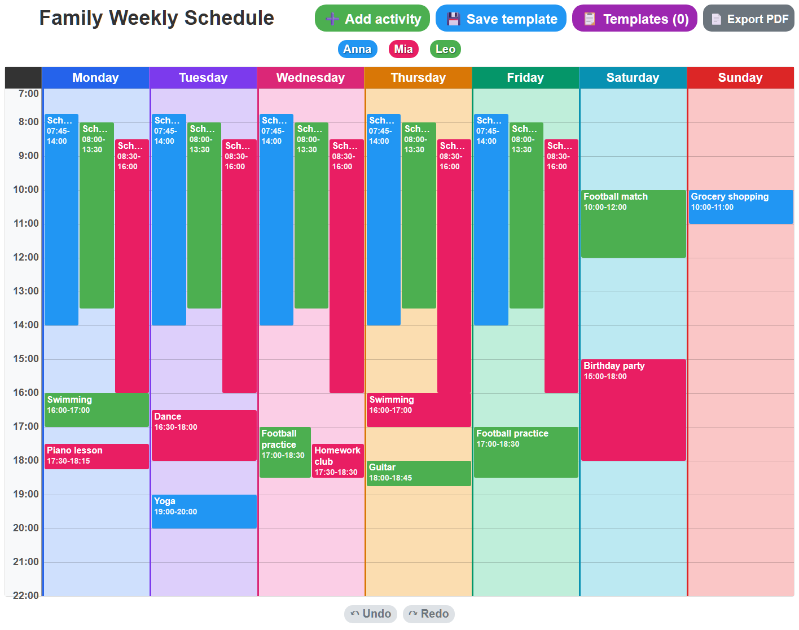
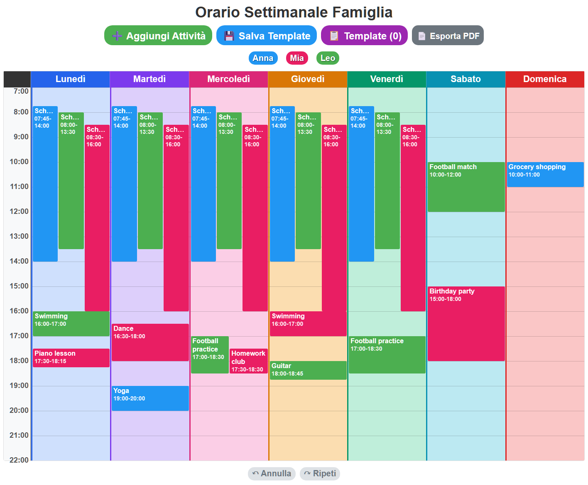
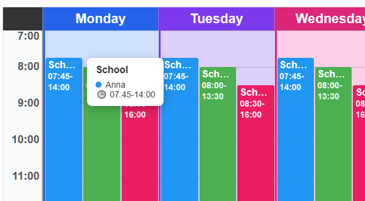

# Intelligent Family Calendar

[](https://github.com/MihaelaAghirculesei/intelligent-family-calendar/actions/workflows/angular-ci.yml)


[](LICENSE)

A weekly planner for a family with several kids: school, sports and music
lessons in one color-coded week that fits on a single printed A4 page.

**[Live demo](https://mihaelaaghirculesei.github.io/intelligent-family-calendar/)**
([English](https://mihaelaaghirculesei.github.io/intelligent-family-calendar/en-US/) ·
[Italiano](https://mihaelaaghirculesei.github.io/intelligent-family-calendar/it/)).
It starts with a made-up family; changes stay in your own browser.



## Why it exists

In a family with several children, school, sports and music lessons overlap
every afternoon. This app keeps the whole week on one page, ready to print and
quick to update when something changes. It started as a single HTML page and
grew, step by step, into the Angular app in this repository.

The family and the schedule in the screenshots are made up.

## Features

- **Time-proportional week grid.** Activities sit at their real start time,
  their height matches their duration, and overlapping ones are laid out side
  by side. The visible hours grow automatically if something starts before
  7:00 or ends after 22:00.
- **Editing in place.** Add activities from a form, double-click a block to
  edit or delete it, and drag it to another day.
- **Undo and redo** for every change to the week (add, edit, move, delete,
  apply a template), with buttons or `Ctrl+Z` / `Ctrl+Y` (`Cmd` on macOS).
  Typing in a field keeps the browser's own text undo.
- **Family members** with their own colors, from a palette or a color picker.
- **Weekly templates.** Save the current week, then re-apply it later as a
  whole; applying a template can be undone too.
- **PDF export** that always fills one landscape A4 page, with or without the
  weekend ([sample PDF](docs/sample-export.pdf)).
- **Readable narrow blocks.** Titles are hyphenated at real syllable breaks; a
  word that still doesn't fit ends with "…", and hovering any block shows its
  full details.
- **English and Italian UI** from the same code base.
- **Saved in the browser** (`localStorage`), with migrations for data written
  by older versions.
- **JSON backups.** Export the week, family members and templates to one file,
  and import it again in any browser; the file is fully checked before
  anything is replaced.

**Italian version** of the same week:



**Hover details** on a narrow block:

<p align="center">
  
</p>

## Tech stack

| Area | Choice |
| --- | --- |
| Framework | Angular 22: standalone components, built-in control flow, signals, zoneless change detection, `OnPush` everywhere |
| Language | TypeScript 6 (strict) |
| State | Signals in services, a `computed` grid layout, persisted to `localStorage` |
| Drag and drop | Angular CDK |
| PDF | `html-to-image` + `jsPDF`, lazy-loaded on first export |
| Hyphenation | `hyphen` (TeX patterns for Italian and English) |
| i18n | `@angular/localize`, build-time, English source + Italian translation |
| Build | `@angular/build` (esbuild + Vite) |
| Tests | Vitest + jsdom via the Angular unit-test builder |
| CI | GitHub Actions on Node 24: type check, production build, tests |

## Quick start

Requires Node.js 22.22+ or 24.15+ (CI runs on Node 24).

```bash
cd angular-version
npm ci
npm run start:en      # English UI on http://localhost:4200
npm start             # Italian UI on http://localhost:4200
```

Other commands, from `angular-version/`:

```bash
npm test -- --watch=false     # unit tests
npm run build                 # production build of both languages
npx ng extract-i18n --output-path src/locale   # extract the English source texts
```

The production build writes one app per language to
`dist/intelligent-family-calendar-angular/browser/en-US/` and `.../it/`.

## Project structure

```
angular-version/src/
├── app/
│   ├── components/      calendar grid, dialogs (activity, person, template, PDF options)
│   ├── services/        calendar, history (undo/redo), persons, templates, PDF export
│   ├── models/          typed activity, history and template models
│   └── pipes/           hyphenation for activity titles
└── locale/              messages.it.xlf (Italian translation)

index.html, styles.css   the original vanilla prototype, kept for reference
```

## Design decisions

**A continuous grid instead of time slots.** The first versions had one row
per fixed time slot, so an activity that didn't match a slot couldn't be shown
at its real time. Now each activity is positioned in pixels from its minutes
since the grid's start hour. Overlapping activities are grouped into clusters,
and each one gets the first free column inside its cluster.

**Undo and redo as recorded actions.** Each change (move, add, edit, delete)
is stored as a small action with what is needed to reverse it, capped at 50
steps. Applying a template replaces the whole week, so that action stores a
snapshot of the week before and after.

**Data stays in the browser, and is migrated.** Without a backend, the stored
format is versioned. Data saved by the old time-slot grid is converted on
load, and family members moved from code defaults into storage with a one-time
migration, so the demo data could change without touching existing calendars.

**PDF export that always fills the page.** Before capturing, the day columns
are resized so the grid has the same proportions as the printable area of an
A4 landscape sheet; the capture then scales onto the page without empty
bands. `html-to-image` replaced `html2canvas` because it lets the browser
render the text, which keeps hyphenation intact. Both PDF libraries are loaded
only when the first PDF is exported.

**Hyphenation in code, not CSS.** `hyphens: auto` only works when the browser
has a dictionary for the page language, which isn't guaranteed for Italian.
A pipe inserts invisible soft hyphens with the patterns for the UI language
instead, and stored titles are never modified.

**Build-time i18n.** With `@angular/localize`, each language is a separate,
fully translated build, so there is no translation lookup at runtime. A
missing Italian translation fails the build, which CI checks on every push
that changes the app.

**Signals and no zone.js.** The services hold their state in signals, the
grid layout is a `computed` that only reruns when the week changes, and every
component is `OnPush`. Without zone.js, Angular refreshes a view only when a
signal it reads, an event in its template or an input changes, so state that
changes after an `await` (the PDF export, reading an imported file) lives in
signals too. Dropping zone.js cut the polyfills from 35 kB to under 1 kB.

## How it evolved

1. **August 2025: vanilla prototype.** A static HTML table with print styles,
   later drag and drop, undo/redo and PDF export in plain JavaScript. It is
   still in the repository root.
2. **August–September 2025: Angular 17 rewrite.** Services, typed models,
   CDK drag and drop, custom family members, templates.
3. **August 2026: real-world fixes.** The continuous time grid, a CI
   pipeline, and PDF export tuned until the printout was readable.
4. **October 2026: preparing it for others to read.** Removed dead code, added
   unit tests, upgraded Angular 17 → 22 one major version per commit, moved
   from Karma to Vitest, and added English/Italian i18n with fictitious
   demo data.
5. **October 2026: signals and zoneless.** Moved the state to signals, made
   every component `OnPush` and removed zone.js, checking every feature in a
   real browser along the way.

## Limitations

- **No accounts or sync.** Data lives in the browser's `localStorage`;
  moving it to another browser or device takes a manual JSON export and
  import.
- **One template week.** The calendar holds a typical week, not dated events,
  so there is no recurrence or calendar sync.
- **Drag and drop changes the day, not the time.** Times are edited in the
  edit form.
- **Mouse-first.** The hover details have no touch equivalent yet; on narrow
  screens the grid scrolls horizontally.
- **Unit tests only.** Services, layout logic, shortcuts and pipes are covered
  by Vitest; there are no end-to-end tests.
- **The vanilla prototype** in the root is kept for history and is not
  maintained.

## License

[MIT](LICENSE)
